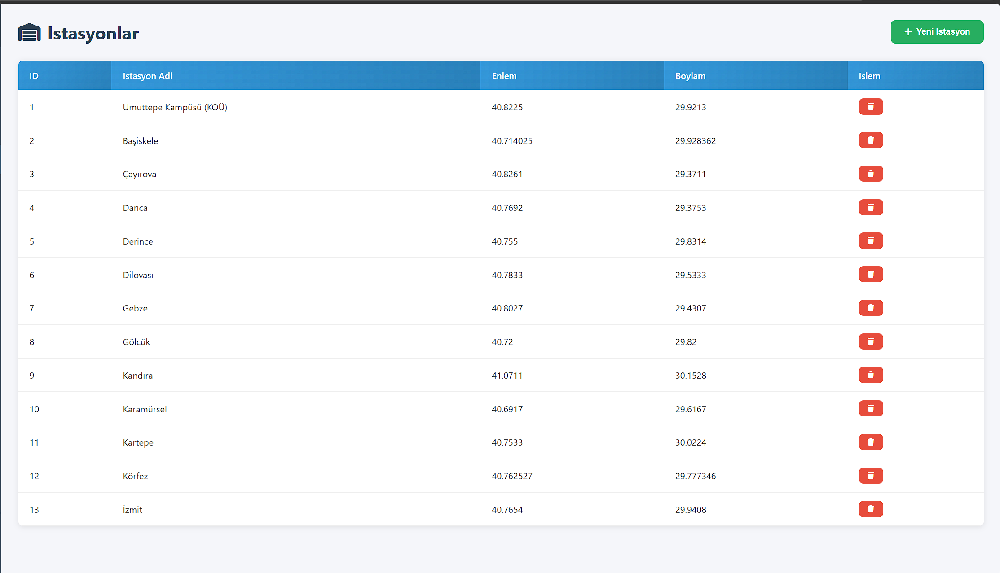
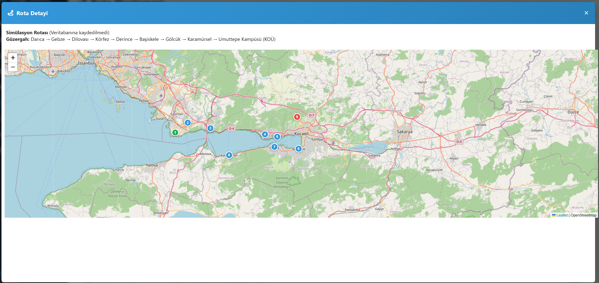

# Kargo Yönetim Sistemi

Kocaeli'deki istasyonlar arasında kargo dağıtımını planlayan web uygulaması. Rota optimizasyonu ve kargoları araçlara yerleştirme (bin-packing) özellikleri var.


| İstasyonlar (13 Kocaeli ilçesi) | Araçlar (500/750/1000 kg) |
|---|---|
|  |  |
| **Harita (Leaflet)** | **Rota planlama** |
|  |  |

Örnek bir rota: Darıca, Gebze, Dilovası, Körfez, Derince, Başiskele, Gölcük, Karamürsel, Umuttepe Kampüsü. Duraklar haritada sırayla numaralı gösteriliyor:



## Neler var

- 13 Kocaeli ilçesi için istasyon yönetimi (enlem/boylam ile)
- 500, 750 ve 1000 kg kapasiteli araçlar
- Kargoların araçlara atanması
- Rota optimizasyonu: Haversine mesafesi, yol mesafesi tablosu, en yakın komşu ve 2-opt ile TSP
- Bin-packing: en çok kargo, en çok ağırlık ya da dengeli dağıtım seçilebiliyor (az kargoda tüm ihtimaller denenir, çok kargoda açgözlü yöntem kullanılır)
- Leaflet haritası, Chart.js ile istatistik grafikleri
- Kullanıcı kaydı, girişi ve e-posta ile şifre sıfırlama

## Kullanılanlar

Python (framework yok, `http.server` ile yazıldı), MySQL, Leaflet.js, Chart.js, OSRM

## Çalıştırma

Docker ile:

```
docker compose up
```

`http://localhost:8000` adresinde açılır, MySQL tabloları uygulama kendisi oluşturuyor.

Docker olmadan:

```
pip install -r requirements.txt
```

Ortam değişkenleri (Windows):

```
set DB_HOST=127.0.0.1
set DB_USER=root
set DB_PASSWORD=mysql_sifreniz
set DB_NAME=kargo_sistemi
set SENDER_EMAIL=gmail_adresiniz
set SENDER_PASSWORD=gmail_uygulama_sifreniz
python app.py
```

`SENDER_PASSWORD` normal Gmail şifresi değil, Google hesabından oluşturulan "uygulama şifresi" olmalı. Uygulama `http://localhost:8000`, veritabanı görüntüleyici `http://localhost:8000/db-view` adresinde açılıyor. Windows'ta `start.bat` ile de açılabilir (önce `DB_PASSWORD` ortam değişkenini ayarlamak gerekiyor).

## Yardımcı dosyalar

- `check_db.py`: veritabanı durumunu yazdırır
- `fix_db.py`: kargo ve rota verilerini temizler
- `update_coords.py`: istasyon koordinatlarını günceller
