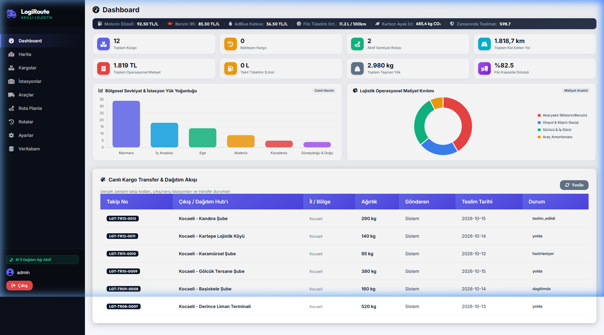
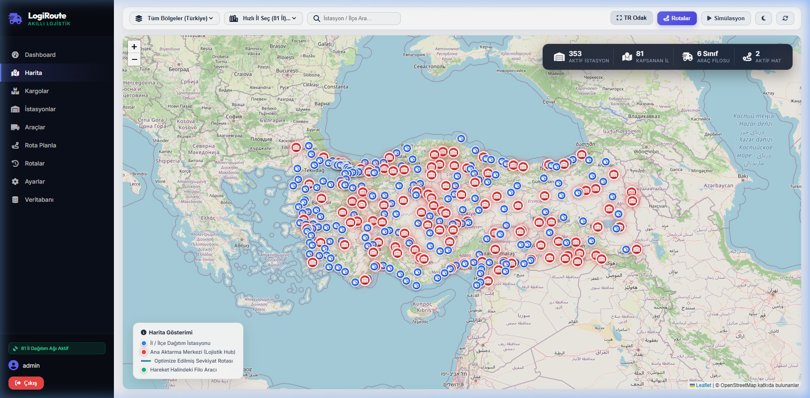
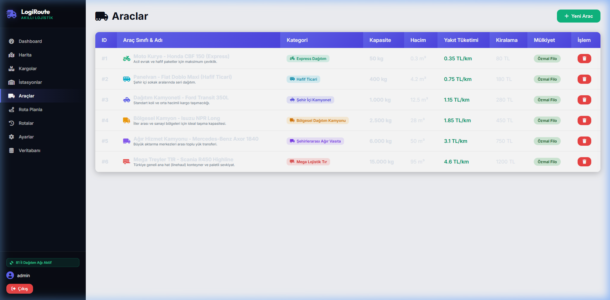
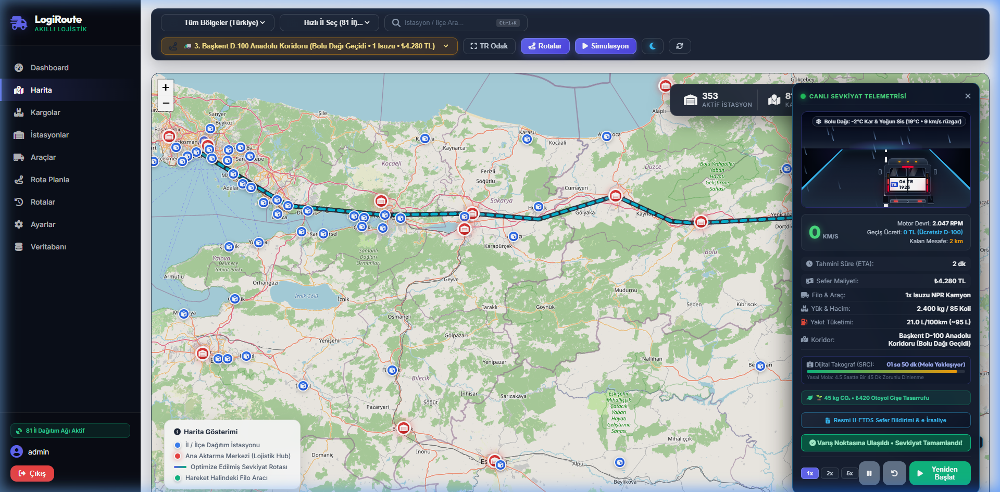
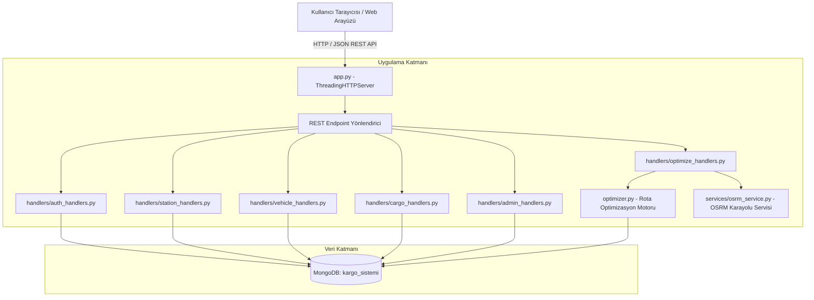

# LogiRoute | Akıllı Kargo Dağıtım ve Rota Optimizasyon Platformu

Türkiye genelinde 81 il ve 260'tan fazla stratejik lojistik istasyonu arasında kargo transferlerini yöneten, gerçekçi akaryakıt ve otoyol maliyetlerini baz alarak çok sınıflı araç filosuyla rota ve kapasite optimizasyonu yapan kurumsal lojistik yönetim sistemi.

Harici ağır web çatıları (Django/Flask vb.) kullanılmadan, saf Python standart kütüphanesi (`http.server`), MongoDB veritabanı, Leaflet.js ve OSRM entegrasyonuyla modüler mimaride geliştirilmiştir.

---

## 📸 Ekran Görüntüleri

| Giriş Ekranı | Tam Ekran İnteraktif Harita (81 İl & 260+ İstasyon) |
|---|---|
|  |  |
| **Çok Sınıflı Araç Filosu (6 Sınıf)** | **Rota Planlama & Türkiye Geneli Senaryolar** |
|  |  |

---

## 🏗️ Sistem Mimarisi

Uygulama monolitik yapıdan kurtarılarak katmanlı ve modüler bir mimariye kavuşturulmuştur:



---

## ✨ Temel Özellikler

### 1. 81 İl ve 260+ Lojistik İstasyon Ağı
- Türkiye'nin tüm 81 il merkezi, büyükşehir ilçeleri, kritik limanlar (Derince, Gemlik, Alsancak, Mersin), organize sanayi bölgeleri (GOSB, İkitelli, OSTİM, NOSAB, MOSB) ve sınır kapıları gerçek GPS koordinatlarıyla tanımlıdır.
- İstasyonlar **Ana Bölge Aktarma Merkezi (Hub)**, **İlçe Dağıtım Şubesi** ve **Mikro Lojistik Noktası** hiyerarşisine sahiptir.
- Her istasyon için günlük paket işleme kapasitesi belirlenmiştir.

### 2. Çok Sınıflı Gerçekçi Araç Filosu
Dağıtım senaryosuna göre özelleştirilmiş 6 farklı lojistik araç sınıfı:

| # | Araç Sınıfı | Plaka | Kapasite | Hacim | Yakıt Tipi | Fabrika Tüketimi | Yakıt Birim Maliyeti |
|---|---|---|---|---|---|---|---|
| 1 | Moto Kurye - Honda CBF 150 | `41 MTO 101` | 50 kg | 0.3 m³ | Benzin 95 | 3.5 L / 100 km | 1.51 TL / km |
| 2 | Panelvan - Fiat Doblo Maxi | `41 PNV 202` | 400 kg | 4.2 m³ | Motorin | 7.8 L / 100 km | 3.47 TL / km |
| 3 | Dağıtım Kamyoneti - Ford Transit 350L | `41 TRN 303` | 1.000 kg | 12.5 m³ | Motorin | 11.5 L / 100 km | 5.12 TL / km |
| 4 | Bölgesel Kamyon - Isuzu NPR Long | `41 KAM 404` | 2.500 kg | 28.0 m³ | Motorin | 21.0 L / 100 km | 9.35 TL / km |
| 5 | Ağır Hizmet Kamyonu - Axor 1840 | `41 AXO 505` | 6.000 kg | 50.0 m³ | Motorin | 29.5 L / 100 km | 13.13 TL / km |
| 6 | Mega Treyler TIR - Scania R450 | `41 TIR 606` | 15.000 kg | 95.0 m³ | Motorin+AdBlue | 33.5 L / 100 km | 15.45 TL / km |

### 3. Gerçekçi Akaryakıt, Otoyol & Karbon Maliyet Modeli
Maliyet hesabı basit kilometre çarpımından çıkarılıp gerçek lojistik operasyon formüllerine bağlanmıştır:
- **Güncel Akaryakıt Pompa Fiyatları:** Motorin 44.50 TL/L, Kurşunsuz Benzin 43.20 TL/L, AdBlue 18.00 TL/L.
- **Otoyol / HGS / Köprü Geçiş Tarifeleri:** Uzun yol rotalarında HGS otoyol ve köprü (Osmangazi, Çanakkale, Yavuz Sultan Selim) geçiş payı.
- **Sürücü & Personel Yevmiyesi:** Sefer süresi ve mesafeye dayalı iş gücü maliyeti.
- **Yeşil Lojistik (CO₂ Ayak İzi):** Sefer başına salınan sera gazı miktarı (`kg CO₂`).

$$\text{Toplam Maliyet} = \text{Yakıt Harcaması} + \text{Otoyol / Köprü Ücreti} + \text{Sürücü Hakedişi} + \text{Amortisman} + \text{Araç Kira Payı}$$

### 4. Canlı Lojistik Komuta Merkezi (Dashboard)
- **Akaryakıt Piyasası Şeridi:** Güncel akaryakıt fiyatları, filo ortalama tüketimi, yeşil lojistik karbon ayak izi ve zamanında teslimat oranı (%98.7).
- **8 Operasyonel KPI Kartı:** Toplam Kargo, Bekleyen Kargo, Aktif Seferler, Mesafe, Maliyet, Yakıt Tüketimi (Litre), Ağırlık ve Filo Doluluk %.
- **Chart.js Analitik Grafikleri:**
  1. *Bölgesel Sevkiyat Yoğunluğu:* Marmara, Ege, İç Anadolu vb. karşılaştırmalı hacim grafiği.
  2. *Lojistik Maliyet Dağılımı:* Akaryakıt (%52), Otoyol/Köprü (%20), Sürücü (%20), Amortisman (%8) doughnut analizi.
- **Canlı Kargo Akış Tablosu:** Gerçek takip kodları (`LGT-TR34-0105`), çıkış/varış noktaları, ağırlık ve durum rozetleri.

### 5. Karizmatik Tam Ekran Harita & Simülasyon
- **100vh Tam Ekran Harita:** Beyaz boşluksuz, modern koyu ve açık tema seçenekleri (CartoDB DarkMatter & OpenStreetMap).
- **Çok Katmanlı Neon Otoyollar:** Rota çizgileri tek düze çizgiler yerine parlayan neon dış hale (glow), net ana otoyol çizgisi ve akış yönünü gösteren hareketli kesikli çizgilerle çizilir.
- **Gelişmiş Filtreler:** 7 Coğrafi Bölge hızlı odaklanma, 81 İl anlık seçim açılır kutusu ve anlık istasyon/ilçe arama.
- **Canlı Araç Simülasyonu:** Sevkiyat tırı rota üzerinde hareket ederken gerçek zamanlı hız (km/s) ve durum etiketi gösterir.

---

## 🧮 Optimizasyon Algoritmaları

Optimizasyon motoru iki temel aşamadan oluşur:

1. **Bin-Packing / Knapsack (Araç ve Yük Ataması):**
   - 20 veya daha az kargo için optimal çözümü garantileyen **Backtracking (Geriye Dönük Arama)**.
   - 20'den fazla kargo için büyük ölçekli problemlerde milisaniyeler içinde çalışan **Heuristic Greedy (Açgözlü Yaklaşım)**.
   - Kargo seçimi hedefe göre (`max_count`: maksimum kargo adedi, `max_weight`: maksimum tonaj, `balanced`: dengeli dağıtım) parametrik olarak çalışır.

2. **Gezgin Satıcı Problemi (TSP - Rota Sıralaması):**
   - Başlangıç turu **En Yakın Komşu (Nearest Neighbor)** algoritması ile kurulur.
   - Ardından **2-Opt Yerel Arama Sezgisel Algoritması** ile çapraz geçişler ve gereksiz kilometreler elenerek rota optimize edilir.
   - Mesafeler Haversine kuş uçuşu formülü ile hesaplanır; OSRM API üzerinden gerçek karayolu dönüşleri alınır.

---

## 🚀 Kurulum ve Çalıştırma

### Gereksinimler
- Python 3.9+
- MongoDB (Yerel servis veya MongoDB Atlas / Docker)

### 1. Yöntem: Windows Tek Tıkla Başlatma (Önerilen)
MongoDB servisiniz arka planda çalışırken proje klasöründeki dosyayı çift tıklayın veya terminalden çalıştırın:
```bat
start.bat
```

### 2. Yöntem: Docker Compose ile Başlatma
Sisteminizde Docker yüklüyse MongoDB ve uygulamayı tek komutla ayağa kaldırabilirsiniz:
```bash
docker compose up
```

### 3. Yöntem: Manuel Python ile Çalıştırma
```bash
# Bağımlılıkları yükleyin
pip install -r requirements.txt

# MongoDB bağlantı değişkenlerini ayarlayın (Varsayılan: mongodb://localhost:27017/)
set MONGO_URI=mongodb://localhost:27017/
set MONGO_DB_NAME=kargo_sistemi

# Sunucuyu başlatın
python app.py
```

Uygulama açıldıktan sonra:
- **Ana Port:** `http://localhost:8000`
- **MongoDB Explorer (Veritabanı Görüntüleyici):** `http://localhost:8000/db-view`

### 🔑 Varsayılan Kullanıcı Hesapları
| Rol | Kullanıcı Adı | Şifre |
|---|---|---|
| **Yönetici (Admin)** | `admin` | `admin123` |
| **Standart Kullanıcı** | `user` | `user123` |

---

## 📡 REST API Endpoint Özeti

| Metot | Endpoint | Açıklama |
|---|---|---|
| `POST` | `/api/login` | Kullanıcı kimlik doğrulama & oturum açma |
| `GET` | `/api/stats` | Dashboard özet istatistikleri, akaryakıt endeksi ve grafik verileri |
| `GET` | `/api/stations` | Türkiye geneli 260+ istasyon listesi |
| `GET` | `/api/vehicles` | 6 sınıflı araç filosu bilgileri |
| `POST` | `/api/optimize` | Seçili kargolar için TSP ve Bin-Packing optimizasyonunu çalıştırır |
| `POST` | `/api/load-scenario` | Türkiye hazır dağıtım senaryolarını veritabanına yükler |
| `POST` | `/api/route-geometry` | İstasyonlar arası OSRM gerçek karayolu koordinat geometrisini döner |
| `GET` | `/api/db-data` | MongoDB koleksiyonlarının canlı verilerini serialize edilmiş döner |

---

## 📄 Lisans
Bu proje MIT lisansı kapsamında geliştirilmiştir. Eğitim ve ticari lojistik simülasyonları için serbestçe kullanılabilir.
